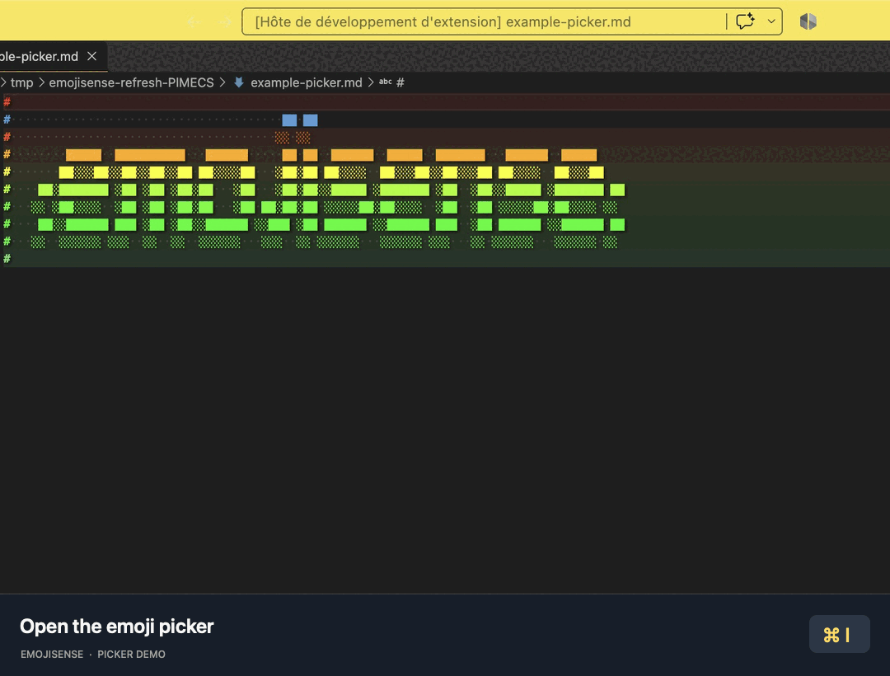

# :emojisense:

Adds suggestions and autocomplete for emoji to VS Code.


Inspired by the [Atom autocomplete+ emojis suggestions plugin][atom].

## Features

- :smile: Quickly **insert emoji** using the `:smile:` syntax supported by Github and many other sites
- :symbols: **Insert emoji markup** by typing `::`
- :gear: Enable and control **emoji completion settings** per language
- :eyes: See **emoji previews** of `:smile:` style markup inline
- :memo: Can be enabled in VS Code's SCM (git) input box.
- :mag: Provide an **emoji picker** to select and insert an emoji in the editor or terminal.
  - To access the picker, run the `Emojisense: Pick an emoji` command, or use the default keybindings:
    - Mac: <kbd>cmd</kbd> + <kbd>i</kbd>
    - Linux: <kbd>ctrl</kbd> + <kbd>alt</kbd> + <kbd>i</kbd>
    - Windows: <kbd>ctrl</kbd> + <kbd>i</kbd>
  - To access the **emoji-code picker** and insert `:emoji:` markup in the editor or terminal, run the `Emojisense: Pick an :emoji:` command, or use the default keybindings:
    - Mac: <kbd>shift</kbd> + <kbd>cmd</kbd> + <kbd>i</kbd>
    - Linux: <kbd>shift</kbd> + <kbd>ctrl</kbd> + <kbd>i</kbd> in the editor; add <kbd>alt</kbd> in the terminal
    - Windows: <kbd>shift</kbd> + <kbd>ctrl</kbd> + <kbd>i</kbd>
  - :currency_exchange: Switch emoji / `:shortcode:` insertion with <kbd>Tab</kbd> or the insertion-mode button.
  - :control_knobs: Cycle description display with <kbd>Shift</kbd> + <kbd>Tab</kbd> or the display button.
  - :mag: Toggle description and tag search with <kbd>Cmd</kbd>/<kbd>Ctrl</kbd> + <kbd>Shift</kbd> + <kbd>D</kbd> or the search button.

    These three shortcuts apply while the search input is focused; changes last for the current picker session.

  - :clipboard: Copy the highlighted emoji or shortcode with <kbd>Cmd</kbd>/<kbd>Ctrl</kbd> + <kbd>C</kbd>, or an item's copy button. A brief checkmark confirms copying; the picker stays open.
  - :scroll: Both pickers share the last **200 insertions**, most recent first, across editors, terminals, workspaces, and restarts.

:open_book: [List of supported emoji][cheat]



## General Configuration

- `emojisense.unicodeCompletionsEnabled`: Enable completions that insert emoji as unicode, i.e. `:smile_cat:` -> 😸

- `emojisense.markupCompletionsEnabled`: Enable completions that insert emoji markup, i.e. `::smile_cat` -> `:smile_cat:`

- `emojisense.showOnColon`: Should emoji completions automatically be shown when you type a colon? Enabled by default. If you disable `showOnColon`, it is recommended that you have `quickSuggestions` enabled.

- `emojisense.emojiDecoratorsEnabled`: Show emoji decorators inline for `:smile_cat:` markup in a file? Enabled by default in markdown.

## Picker Configuration

- `emojisense.picker.ignoreSpaces`: Ignore literal space characters when matching in either picker (for example, `s mile` matches `smile`), while preserving the text you type. Enabled by default. Tabs and other whitespace characters are not ignored. Set this to `false` to use native filtering alone. Native matches keep their highlighting; additional matches found by ignoring spaces may have no blue highlighting.

- `emojisense.picker.description.search`: Search human-readable descriptions and #tags independently of their display. Enabled by default. Type `#happy` to match tags or `happy` for a broader search. Combine tags and text in either order (`#happy face` or `face #happy`); all tag terms and the text must match. The search button or <kbd>Cmd</kbd>+<kbd>Shift</kbd>+<kbd>D</kbd> (macOS) / <kbd>Ctrl</kbd>+<kbd>Shift</kbd>+<kbd>D</kbd> (Windows/Linux) toggles matching for the current picker. Emoji and shortcode matching remains enabled. Additional custom matches, including hidden descriptions, may have no blue highlighting.

- `emojisense.picker.description.display`: Display descriptions and tags beside the shortcode (`"description"`, default), below it (`"detail"`), or hide them (`"no"`). Inline text uses a visible separator: `:smiley: · grinning face with big eyes · #happy #joy #haha`. The display button or <kbd>Shift</kbd>+<kbd>Tab</kbd> in the search input cycles `no → description → detail → no` for the current picker. Display changes do not affect searching; both settings determine the defaults when reopening.

- `emojisense.picker.preferExactMatch`: Prefer exact shortcode matches and automatically focus them in the emoji picker, so <kbd>Enter</kbd> selects them. Enabled by default. Names are matched without case sensitivity, with or without surrounding colons (for example, `smile` or `:smile:`). Other fuzzy matches remain available, and you can use the arrow keys to select another result.

- `emojisense.picker.preferPrefixMatch`: Prefer shortcode prefixes ahead of other fuzzy matches when preparing results. Enabled by default. For example, the extension prioritizes `smile`, then `smile_cat`, then fuzzy matches such as `sweat_smile`; native sorting of shortcode labels can change their visible order. Set both match preferences to `false` to disable extension prioritization. Native VS Code sorting still applies to shortcode labels. Set `ignoreSpaces` to `false` too to disable space-insensitive matching. Shared recent history still appears first.

## Per Language Configuration

*Emojisense* is enabled by default in markdown, git commits, and plaintext files. You can enable it in other languages using `"emojisense.languages"`

```jsonc
"emojisense.languages": {
    "markdown": true,
    "plaintext": false,
    "json": true,
    "scminput": true // language used in the source control commit message box
}
```

The language keys here come from [VS Code's list of language identifiers](https://code.visualstudio.com/docs/languages/identifiers).

You can also change the settings for each language. Here's the default emojisense configuration for example:

```jsonc
"emojisense.languages": {
    "markdown": true,
    "plaintext": {
        "markupCompletionsEnabled": false,
        "emojiDecoratorsEnabled": false
    },
    "scminput": true // language used in the source control commit message box
}
```

Whenever a value is left unspecified, the top level setting is used instead. In this case, markdown files will fallback to use the top level `emojisense.unicodeCompletionsEnabled` and `emojisense.markupCompletionsEnabled` settings, while plaintext files will have `markupCompletionsEnabled` disabled and fallback to the `emojisense.unicodeCompletionsEnabled` setting.

You can enable emojisense for all languages using `*`:

```jsonc
"emojisense.languages": {
    "*scminput*": true
}
```

## Development

Run `npm ci`, then `npm test` to run the picker regression tests. The tests exercise the TypeScript implementation with mocked VS Code APIs, covering exact and prefix preferences, candidate retention, and editor/terminal insertion. Native VS Code filtering and rendering require a separate extension-host check.

## Credits

- Icon from emojione: https://www.emojione.com
- [Atom autocomplete+ emojis suggestions plugin][atom]


[atom]: https://atom.io/packages/autocomplete-emojis
[cheat]: https://github.com/ikatyang/emoji-cheat-sheet
